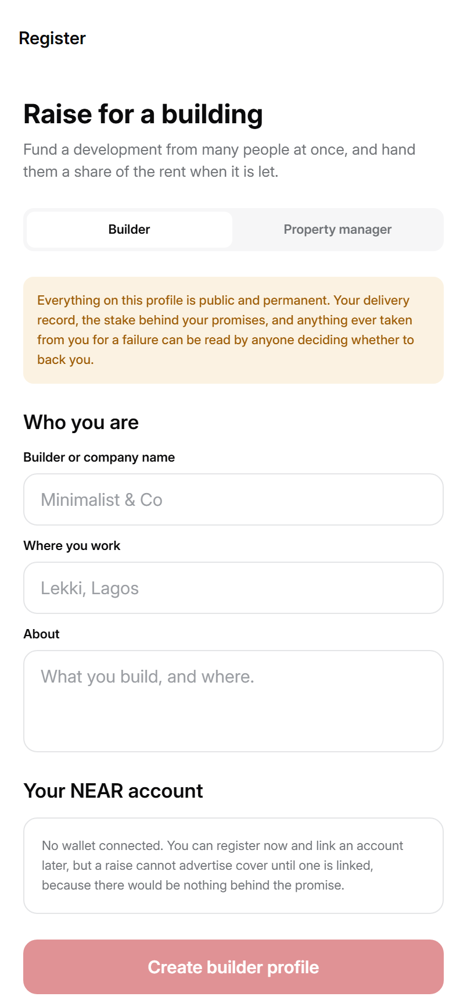

# Sheda Solutions

**Making real estate operations affable, available, affordable, and secure through blockchain for buyers, sellers, and everyone in between.**

A full real estate platform on NEAR. Search verified listings, book an inspection, agree terms, sign on chain and pay, all in one place, with no intermediary taking a cut between the two people doing the deal.

**App:** https://market.sheda.app · **Testnet:** https://testing.sheda.app · **Site:** https://sheda.app · **Network:** NEAR

<p align="left">
  
  
</p>

---

## NEAR Hackathon 2026

**Tracks:** [`nfts`](https://nearhackathon.com) (primary) and
[`realworld`](https://nearhackathon.com) (secondary).

The property NFT is the flat, and the flat is owned by a vault account. The
vault mints NEP-141 shares when the raise funds and pays its rent to whoever
holds them. That is the `nfts` claim: the NFT owns a real, income-producing
thing. The listings, inspections, escrow, leases and USDC settlement around
it are the `realworld` claim: the NFT is part of a product people can use
without knowing what a vault is.

**Try it (no install):** open https://testing.sheda.app → Continue with
Google (a NEAR testnet wallet is created for you) → Portfolio → **Get test
dollars** → Invest → **Yaba Test Terraces** → **Invest now**. The full
"do this, see that" path is in [docs/DEMO.md](docs/DEMO.md).

- [Submission notes and baseline disclosure](docs/HACKATHON_SUBMISSION.md)
- [Five-minute demo: do this, see that](docs/DEMO.md)
- [Contract deployment runbook](docs/DEPLOY_COLLECTIONS.md)

**Baseline.** The marketplace and Collections code existed before the event
in five separate public repositories under the same organisation. They were
consolidated into this monorepo on 2026-11-08. The `pre-hackathon` tag (also
`monorepo-baseline`) points at that first monorepo commit, and
`hackathon-submission` at the submitted state. The diff between them is the
work done during the event:
[pre-hackathon...hackathon-submission](https://github.com/shedasolutions-design/sheda-platform/compare/pre-hackathon...hackathon-submission).
The status table below separates what is working from what is deliberately
still missing.

---

## What the platform does

Property transactions are slow, paper-heavy and built on trusting people you have never met. A deposit sits with someone you hope will return it. A title exists as a document someone could reprint. An agent stands between the buyer and the seller and is paid for being there.

Sheda puts the parts that need to be trustworthy on chain, and keeps everything else ordinary.

**For someone buying or renting**

- Search verified listings and filter by what matters to you
- Book an inspection directly with the owner, around their real availability
- Make an offer, negotiate, and agree terms in the app
- Pay into escrow that a contract releases, not a person
- Receive the documents on chain, where they cannot be quietly reissued

**For someone selling or letting**

- List a property and have it minted as an NFT you own
- Receive and review offers from verified buyers
- Release documents and take payment when the contract says the conditions are met
- Manage tenants, leases, renewals and deposits from one place
- Raise a dispute or a damage claim against a deposit, with an on-chain record

**Underneath**

- A wallet built into the app. No extension, no seed phrase to understand, no "connect your wallet" step. Account creation, signing and recovery are handled for you.
- Prices in **14 currencies** across four continents, settled in Circle USDC.
- Identity checks, ratings, in-app chat and notifications, because a marketplace is a place where people meet before it is anything else.

The blockchain is deliberately not the product. It is what makes the escrow releasable by rule rather than by permission, and the documents impossible to quietly change.

---

## Invest (Collections): fractional ownership

The second item on the Sheda roadmap, and the reason most of this repository exists. People see it as **Invest**; the code calls it Collections.

> **Fractional Ownership & Yield Investments.** Affordable entry into premium properties, NFT-backed ownership receipts, and transparent yield distribution.

Property is the asset most people would choose and the one most are priced out of. The usual answer is a fund or a REIT: you own a slice of a pool, you do not know which building, and you trust an intermediary to tell you what it earned.

Collections does the opposite. You buy shares in **one specific flat**, often before it is built. The rent that flat earns is divided among the people who hold its shares, in proportion, in arrears, on chain. Nobody reports the figure to you, because nobody has to.

Someone who cannot buy a whole apartment can own 1.39% of one, and receive 1.39% of its rent for as long as they hold it.

---

## The NFT is the flat. The shares are a fungible token.

This is the design decision the whole system rests on.

A property is an **NEP-171 NFT**, because a flat is a *specific* flat: unit 1B on the third floor, with its own address, its own tenant and its own rent. That identity cannot be divided without destroying what makes it an asset.

The claims on it are an **NEP-141 fungible token**, because ten people splitting a flat do not own ten distinguishable things. They own ten identical claims, and the point is that those claims divide again, add together, and sell in part. A tenth of the rent is a tenth of the rent.

The alternative, numbered sub-NFTs, means writing division, merging and partial transfer by hand, and every one of those is a place to get arithmetic wrong with other people's money.

**What this buys:** the marketplace knows one thing about ownership, that a property NFT has an owner account which lists it, accepts bids and gets paid. It never asks whether that account belongs to a person. A vault *is* an account. It holds the NFT, so it is the landlord, and **the marketplace needed no change at all** for a flat owned by three hundred people to be rented exactly like a flat owned by one.

```
NEP-171 NFT  ──owned by──>  Vault account  ──shares──>  NEP-141 FT
  the flat                   the landlord                the holders
```

---

## How a raise works

1. A builder registers. The profile is public and permanent: logo, delivery record, stake posted, anything ever slashed.
2. They open a raise: project type (off-plan, under construction, or completed and ready to rent), map location, the flats it divides into with each flat's expected yearly rent, a minimum investment, and a phase schedule that must release **exactly** 100% of the target. A completed building has one handover payment.
3. They suggest up to three **property managers** near the project. Each manager accepts with their fee and their **pledge**, the terms they work to; accepting fixes both for that raise. The builder's own company may be suggested only when nobody else is available, and investors are told.
4. They upload the **project pack**: every agreement and term in one document. A raise cannot open without it, its SHA-256 fingerprint is recorded on chain, and it cannot be swapped once money is in.
5. Sheda checks the documents and opens the raise on chain. Deliberately not the builder's step: the terms are what investors commit against.
6. People invest in four steps (flat, amount, terms, confirm), choosing a specific flat and **voting for a manager** with their money. While a round fills they may take their money out, except when it is full or in its last 7 days. If it misses its deadline, everyone takes everything back.
7. When the round fills, the most-voted manager is fixed. The build runs a phase at a time: the builder says a phase is finished, the manager inspects and signs off, and holders have seven days to object; a quarter objecting holds the payment. If the manager is the builder's own company, each payment instead needs **approval from more than half** of the money.
8. Once let, rent arrives at the flat's vault and is divided among its shareholders, after the manager's fee, a 5% repair reserve and Sheda's 2%.

Holders can **sell shares to each other** inside each flat's vault: listed shares stay in the seller's balance and keep earning rent until sold, and a buyer's payment and the shares move in one transaction. Buy offers work the other way round. Holders of more than half of a flat's shares can **replace its manager**.

Followers of a building (everyone who invested or bought shares, or tapped Follow) get **Invest updates** in the app and by email: a round closing or missing its deadline, filling, phases signed off and paid, the build stopping, flats handed over, listed and let.

If the build stalls, the builder's posted stake is what investors recover. A guarantee the builder can walk away from is not a guarantee.

**Fees.** Sheda takes 2% of every completed transaction and nothing from refunds: a raise once it fills, rent, share sales, and home sales and rentals on the marketplace. Testnet fees go to `shedauser.testnet`; mainnet's will go to `shedasolutions.near`.

---

## Builders and managers are ranked, and the ranking shows its working

Collections ranks the people you are trusting with your money, and that ranking is computed **in the app**, never on the server.

The backend returns the counts: raises completed, completed late, abandoned, stake posted, stake slashed, months a unit sat empty. It returns no score and no ordering. The directory endpoint deliberately hands back an unordered list, because ordering would mean scoring.

The reason is narrow. The product tells people Sheda does not adjust these rankings. That claim only holds if the scoring lives somewhere a reader can audit, computing from facts the chain already published. A score arriving from a server could only be believed.

So every profile shows its working:

```
Delivery        41.7 of 50    2 on time, 1 late, 0 abandoned, of 3 finished
Cover posted    18.2 of 25    18.2% of everything raised is backed by their own stake
Integrity         25 of 25    No stake has ever been slashed
```

A late job counts for half, because the building did get built. An abandoned one counts against, because otherwise a builder dilutes a walk-away by opening more raises.

Below a minimum history there is no score at all. A builder with one finished job is not excellent and is not poor. Those profiles read **"Not rated yet"**, sit under their own heading, and carry no rank number, because a position at the bottom of a single list would read as "worst" when what is true is that nobody knows yet.

---

## The repository

```
sheda-platform/
├── apps/web/             Next.js 16 web app. THE product: every screen is here.
│   ├── src/app/              routes: (auth), (tabs), collections, wallet-setup …
│   ├── src/app/api/near/     server-only routes (wallet funding holds a key)
│   ├── src/contexts/         API, wallet, currency, mode
│   ├── src/services/         backend client, NEAR wallet/contracts, Firebase backup
│   └── next.config.ts        browser security rules (CSP and headers)
├── apps/mobile/          The old Expo app. Kept for reference; not deployed from here.
├── apps/collection-app/  Expo app. Collections as a standalone product.
├── services/backend/     FastAPI + Postgres. One deployment per network.
│   └── src/core/admin/       the admin panel and its Smart contracts page
├── contracts/            NEAR. What has to be true without trusting us.
│   ├── market/               listings, bids, escrow, deposits, disputes
│   ├── vault/                one flat, its shares, its rent
│   ├── raise/                escrow, phases, refunds, opt-outs
│   └── stake-registry/       builder and manager stake
├── .github/workflows/    CI, and the marketplace deploy/staging/undeploy jobs
└── docs/ARCHITECTURE.md
```

One rule decides every placement:

**The chain holds anything that decides ownership.** Share balances, escrow, the stake behind a builder's promises, which phase has been released. These cannot be edited by anyone with database access, including us.

**The backend holds what a contract is the wrong place for.** Prose, photographs, title documents, phase names, and a cache of chain events so a directory can be sorted without every client replaying the chain.

**No figure appears in both.** A second copy of a number that decides who owns what is a second answer waiting to contradict the first.

---

## Live

Testnet and mainnet are completely separate: each has its own backend, its own
database, its own secrets and its own admin login. The same email can hold an
account on both without the two ever meeting.

| | Testnet | Mainnet |
| --- | --- | --- |
| Web app | https://testing.sheda.app (branch `TT`) | https://market.sheda.app (branch `main`) · app.sheda.app redirects here |
| Backend | https://api-testnet.sheda.app (Railway service `api`) | https://api.sheda.app (Railway service `api-mainnet`) |
| Database | Neon `sheda-platform`, London | Neon `sheda-mainnet`, London |
| Admin panel | api-testnet.sheda.app/sheda-backend | api.sheda.app/sheda-backend |
| Wallets accepted | `*.testnet` only | `*.near` only |

**Until mainnet launches, market.sheda.app runs on testnet** and talks to
api-testnet: the mainnet contracts are not deployed and the mainnet funding
account is empty. Switching it is two Vercel settings and a rebuild:
`NEXT_PUBLIC_API_URL=https://api.sheda.app` and `NEXT_PUBLIC_NEAR_NETWORK=mainnet`.

- **Web hosting:** Vercel project `sheda-web`, root directory `apps/web`. Its
  settings live in Vercel only: public ones (`NEXT_PUBLIC_*`, API address,
  network, Google client ID, Firebase web config) and server-only secrets
  (`NEAR_TESTNET_FUNDING_PRIVATE_KEY`, `NEAR_MAINNET_FUNDING_PRIVATE_KEY`,
  stored as *sensitive*).
- **Backends:** Railway project `sheda-platform`, EU West. Deploy from
  `services/backend` with `railway up --service api` (testnet) or
  `--service api-mainnet`. Migrations run on start. Each backend sets
  `NEAR_NETWORK`, `ORIGINS` (the only sites allowed to call it) and its own
  `SECRET_KEY`/`ADMIN_SECRET_KEY`.
- **DNS:** sheda.app is on Vercel DNS. `api` and `api-testnet` are CNAMEs to Railway.
- **Google:** one OAuth web client for sign-in; its redirect URIs are
  `https://market.sheda.app/google-auth` and `https://testing.sheda.app/google-auth`.
  Firebase project `sheda-app` holds the encrypted wallet backups.

**Secrets never go in this repository.** They live in Railway and Vercel
settings, and locally only in git-ignored `.env.local` files.

---

## Contracts

NEAR testnet. Built by CI and deployed from that wasm, so the binary is one anyone can reproduce.

| Contract | Account |
| --- | --- |
| Marketplace (v5: 2% fee on completed owner payments, set by the council with `set_platform_fee`) | `market-v2.shedauser.testnet` (owner: the council; replaced `market.shedauser.testnet`, whose key was lost) |
| Raise v5: escrow, phases, manager vote, withdrawals | `sheda-raise-v5.testnet` (owner: 2-of-3 council `sheda-council.testnet`; fees to `shedauser.testnet`; pays in `usdc.fakes.testnet`; testnet timings: 3-minute objection window, 2-minute withdrawal cutoff) |
| Raise v4 (the two raises opened before v5) | `sheda-raise-v4.testnet` |
| Flat vaults (v5: rent, share market, manager vote) | One per flat, governed by its raise. The v4 flats `sheda-v4-pgt-t2/t3.testnet` and `sheda-v4-lgf-f1/f2.testnet` were upgraded to v5 code with `migrate()`. |
| Stake registry | `sheda-stake-v5.testnet` (v5), `sheda-stake-v4.testnet` (v4) |

The registry's controller is the raise contract. That is the entire authority to touch a builder's stake: a stalled project can slash the cover allocated to it, and nothing else can reach it.

Each project record names its own raise contract (`escrow_account_id`), and the
app routes every call for that project there, so v4 and v5 raises live side by
side. A v5 raise is opened by the council with `create_project` then `set_terms`
(candidate managers and the project pack's fingerprint), using the terms from
`GET /api/v1/collections/admin/projects/{slug}/chain-terms`. The Collections
wasm is built by [`.github/workflows/collections-wasm.yml`](.github/workflows/collections-wasm.yml).

The marketplace deploys from [`.github/workflows/deploy-market-production.yml`](.github/workflows/deploy-market-production.yml); [contracts/market/DEPLOYMENT.md](contracts/market/DEPLOYMENT.md) covers the first deploy, migrations and the required variables.

Nothing is on mainnet. **None of this has been audited**, and an address there would be a claim that it had.

**Admin functions** (resolving disputes, delisting, stablecoins, timings, admins) are on the
admin panel's *Smart contracts* page. It shows live contract state and turns each action into
the exact NEAR CLI command to sign on your own computer. The panel never holds the owner key.

---

## Running it

Each part stands alone.

```bash
# Contracts: 105 unit tests + 37 marketplace integration tests
cd contracts
cargo test --workspace --lib
cargo test -p sheda-contract        # marketplace tests drive a near-workspaces node
cargo clippy -p sheda-collection-raise -p sheda-collection-vault \
  -p sheda-stake-registry --all-targets -- -D warnings
cargo clippy -p sheda-contract --all-targets -- -W clippy::all
cargo build --workspace --target wasm32-unknown-unknown --release

# Backend: 155 tests; API docs at /sheda-docs, admin panel at /sheda-backend
cd services/backend
cp .env.example .env.local && pip install -r requirements-server.txt
alembic upgrade head && uvicorn main:app --reload --app-dir src
pytest -q
python scripts/sync_collections_chain.py --dry-run   # chain records, no key needed

# Web app
cd apps/web
cp .env.example .env.local && npm install
npm run dev        # http://localhost:3000
npx next typegen && npx tsc --noEmit && npx next build

# Collections app: standalone
cd apps/collection-app
npm install
npm test
npm start
```

The web app's security headers only apply to production builds (`next build`);
development needs `eval` and live-reload sockets they would block.

---

## Decisions that are easy to get wrong

**Money never goes through a JavaScript number.** Every amount is an integer string handled as `BigInt`. A unit price sits inside what a double holds exactly, but the vault's income accumulator is scaled by 1e18 and passes 1e25 in ordinary use, and a holder's claim is `balance * acc_per_share` before it is divided back down. One rule for every amount is cheaper than remembering which ones happen to be safe.

**Nobody is paid when rent arrives.** The obvious implementation loops over holders and pays each, and stops working past a few dozen of them because a transaction has a gas ceiling. It would pass every test and fail once the product succeeded. Instead one number moves, `acc_per_share += income / total_shares`, and holders pull what they are owed. Crediting costs the same for ten holders and ten thousand.

**A balance may not move until both sides are settled.** Without that, someone buying shares on Monday collects rent that accrued in March. A silent bug, favouring whoever trades most, found by the person it robbed.

**The marketplace pays landlords with a plain `ft_transfer`,** which notifies nobody. This was checked by reading the deployed bytecode rather than assumed. So money lands in a vault silently and `sync_income()` goes and looks, comparing the token balance against what was last accounted for.

**A share claim is derived, never requested.** An earlier version let the caller name their own share count and their own vault, which would have let anyone who committed the smallest amount mint as many shares as they liked. Both now come from contract state.

**Testnet and mainnet never share anything.** One database with a "network" column would need every query to remember to filter by it, and one that forgot would show test balances next to real ones. Two databases make that impossible. Each backend also refuses a wallet from the other network at sign-up.

**Writes are never retried against another server.** A write that failed at the transport layer may still have been applied, so retrying it elsewhere can make two bids out of one.

**The owner key of a contract never sits on a server.** The key that resolves a dispute is the same key that can empty the escrow, so the admin panel builds the signing command instead of holding it.

**The browser only talks to servers we name.** The wallet's keys live in the browser, so `next.config.ts` sets a Content-Security-Policy listing every server the app calls. A new service has to be added there, or the browser blocks it.

**Every record lookup checks it is yours.** Ids are sequential, so an endpoint that returns a record by id without checking the caller hands out everyone's. Contact details go only to the person and to someone they have a viewing with.

---

## Status

| | |
| --- | --- |
| Web app: every screen, on market.sheda.app and testing.sheda.app | Working |
| Marketplace: listings, inspections, offers, escrow, leases, documents, disputes | Working |
| Built-in wallet: created and funded automatically at sign-up; import, recovery, Google backup | Working |
| Invest: browse, rank, open a raise, four-step investing, manager vote, withdraw, claim shares, claim rent, share market, Invest updates | Working on testnet (raise v5 live; v4 flats upgraded) |
| Admin panel: dashboard, every table, Smart contracts | Working |
| Contracts: vault, raise, stake registry, marketplace | 105 unit + 37 integration tests; raise and vault v5 live on testnet, live smoke tests passed |
| Mainnet | **Not live.** Backend and database are ready; contracts aren't deployed and the funding account is empty. |
| Per-unit vault deployment | **Operator runbook, not a factory.** `docs/DEPLOY_COLLECTIONS.md` deploys a vault, registers it with the raise and records it in the backend. |
| Cross-contract tests | **Partial.** The marketplace has integration tests under `contracts/market/tests`, including rent reaching a vault and the 2% fee. The raise-to-vault paths are covered by live testnet smoke tests, not yet by sandbox tests. |
| Manager screens | **Working.** A manager sees managed raises, requests, and signs off a phase from the Sign-offs screen; the client cannot sign with the wrong account. |
| Chain-event indexer | **Working for raise and stake facts.** `services/backend/scripts/sync_collections_chain.py` rebuilds builder and manager chain records. Occupancy and rent-period counts need the lease/vault event pipeline and stay at zero until it exists. |
| Invest updates | **Working.** The backend reads followed raises from the chain every 10 minutes (and when someone opens notifications), and turns each change into an in-app update and an email. `POST /api/v1/collections/admin/lifecycle-sweep` with `X-Cron-Key` runs it on demand. |
| Security | Code review done (Nov 2026): data leaks, upload overwrites and unchecked payment actions fixed; admin lockout and authenticator codes; browser security rules. **External contract audit not done.** |
| Email | **Working** through Brevo on testnet and mainnet: sign-up codes, deal updates and Invest updates. |

Still ahead on the Sheda roadmap: real estate services integration (management, legal, insurance), and on-chain importation of existing property.

---

## Where development happens

This repository is the monorepo and the source of truth. Work happens on
`TT`, which deploys to testing.sheda.app on every push. When it is ready,
`TT` is merged into `main`, which deploys to market.sheda.app.
It consolidates the code that was previously developed separately in:

- `shedasolutions-design/sheda-solution-mobile` → `apps/mobile/` (reference only)
- `shedasolutions-design/Sheda-Collection-app` → `apps/collection-app/`
- `shedasolutions-design/Sheda-Backend` → `services/backend/`. A Cloudflare
  Workers copy was tried and removed; it is in this repo's history.
- `shedasolutions-design/sheda-new-contract` → `contracts/market/`
- `shedasolutions-design/sheda-collection-app-contract` → `contracts/{raise,vault,stake-registry}/`

Those repositories are inputs now, not parallel branches of work. New changes
land here.

---

## AI tools and libraries

**AI tools.** Much of this code was written with **Claude Code** (Anthropic),
working in this repository under the team's direction: contracts, backend,
web app, tests and documentation. Every change went through CI (formatting,
lint, unit and integration tests) before it was merged, and contract changes
were also smoke-tested live on testnet.

**Libraries and services.**

- Contracts: `near-sdk` (Rust), `near-contract-standards` (NEP-141, NEP-171),
  `near-workspaces` and `cargo-near` for tests and builds.
- Web app: Next.js, React, Tailwind CSS, `near-api-js` and `@near-js/*`,
  TanStack Query, Redux Toolkit, react-hook-form, zod, lucide-react,
  `@noble/*` and `bip39` for the built-in wallet.
- Mobile and Collections apps: Expo and React Native.
- Backend: FastAPI, SQLAlchemy, Alembic, Pydantic, httpx, starlette-admin,
  pytest.
- Services: Neon (Postgres), Railway (backends), Vercel (web), Cloudinary
  (uploads), Brevo (email), Firebase (encrypted wallet backup),
  OpenStreetMap and Nominatim (maps), FastNEAR (RPC), test stablecoins
  `usdc.fakes.testnet` and `usdt.fakes.testnet`.

---

## Licence

Apache-2.0. See [LICENSE](LICENSE).
